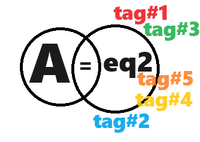

# indexdatabase
Indexing by using plain text SQL

[JSON Databases Explained by MongoDB.com](https://www.mongodb.com/resources/basics/databases/json-database)

## For 8 (infinity) Data

1. By using **folders** : most web hoster limited it as inode quotas to avoid file-system overloads!
2. By using **SQL database** : the solution for above issue to reach infinity bookmarking/indexing.
3. Other

## Input by user

Find a way to have user to input to tagging as many as possible for the "word" AKA. "object" on database.

The tag is just like to hashtag.

The more tagging will define more clarify the "object".

Tagging to define the "object".


---

Every object has a reciprocal relationship. 

For example, A=B(eq2), B=Tag#1, B=Tag#2...B=Tag#n, etc. 

B defines and describes A with more Tag#1...Tag #n for assistance.



```
{
  "A": {
    "eq2": "B",
    "tag1": "4tag1",
    "tag2": "4tag2",
    "tag3": "4tag3",
    "tag4": "4tag4",
    "tag5": "4tag5",
    "others": "4others"
  }
```
